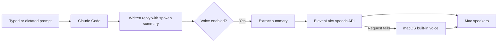

# ElevenLabs Voice Hooks

**Give Claude Code a voice on macOS.**

I already dictate my prompts. I wanted my coding assistant to speak back, so I built a small speech layer with AI assistance: when a reply finishes, it reads a short spoken summary through ElevenLabs. The full answer stays on screen.

This repository contains the Python hooks behind that workflow, plus an experimental Codex notification relay. It calls the ElevenLabs text-to-speech API directly; it does not implement an MCP server.



## What it does

- Reads the text after the last `Spoken summary:` marker.
- Turns speech on or off with `voice on` and `voice off` in Claude Code.
- Keeps the API key in macOS Keychain.
- Falls back to the Mac's built-in `say` voice if key lookup or the API request fails.
- Uses temporary audio files, deleted after normal playback.
- Runs with Python's standard library and macOS command-line tools. No pip packages.

Voice input is separate. Any dictation tool that types into your assistant can supply the prompt. This project adds speech output, without microphone capture or continuous conversation.

## Status

The original Claude Code setup was used for audible replies on the author's Mac. This public copy removes personal paths and passes the API key and speech text to curl through standard input. Automated tests use mocks and make no paid API calls. A fresh installation and actual Codex desktop playback still need an end-to-end check.

## Requirements

- macOS with `curl`, `security`, `afplay`, and `say` available.
- Python 3.9 or newer and Git.
- Claude Code with command hooks, or a Codex client that emits notification events.
- An ElevenLabs API key, available credits, and access to the selected voice/model.

The default voice ID is River and the model is `eleven_flash_v2_5`. Both are constants at the top of `speak.py`; change them if your account requires another voice. Speech consumes your ElevenLabs quota. Check your account's current usage and pricing.

## Set up Claude Code

### 1. Download the project

On your Mac, press **Command-Space**, type **Terminal**, and press **Return**. Run:

```sh
mkdir -p "$HOME/Projects"
git clone https://github.com/narayanakash97/elevenlabs-voice-hooks.git "$HOME/Projects/elevenlabs-voice-hooks"
cd "$HOME/Projects/elevenlabs-voice-hooks"
python3 --version
```

Expect the clone to finish and Python to print version 3.9 or newer. If Git or Python is missing, install it before continuing.

### 2. Store your key

Press **Command-Space**, search for **Keychain Access**, and open it. Select the **login** keychain, then **File > New Password Item**. Enter:

| Field | Value |
| --- | --- |
| Keychain Item Name | `elevenlabs-api-key` |
| Account Name | Your Mac username, printed by `whoami` in Terminal |
| Password | Your ElevenLabs API key |

Click **Add**. Do not put the key into source files or chat. If this item already exists, update its password instead of creating a duplicate.

Back in Terminal, run:

```sh
python3 speak.py "Hello. Your assistant can speak back."
```

You should hear speech. Allow the Keychain access prompt if macOS displays one. A system voice means the fallback ran; it does not prove the ElevenLabs request succeeded. Check Terminal for an HTTP error, your API permissions, and your credit balance.

### 3. Connect the hooks

Run `pwd` and `command -v python3` in Terminal. Keep both paths.

In the project where you use Claude Code, open `.claude/settings.json` in your editor. Create the `.claude` folder and this file if needed. Merge the following entries into its `hooks` object, preserving existing settings and hooks. Replace `/ABSOLUTE/PATH/python3` with the Python path and `/ABSOLUTE/PATH/elevenlabs-voice-hooks` with the cloned folder path:

```json
{
  "hooks": {
    "UserPromptSubmit": [{
      "hooks": [{
        "type": "command",
        "command": "\"/ABSOLUTE/PATH/python3\" \"/ABSOLUTE/PATH/elevenlabs-voice-hooks/prompt_hook.py\""
      }]
    }],
    "Stop": [{
      "hooks": [{
        "type": "command",
        "command": "\"/ABSOLUTE/PATH/python3\" \"/ABSOLUTE/PATH/elevenlabs-voice-hooks/stop_hook.py\"",
        "timeout": 180
      }]
    }]
  }
}
```

Restart Claude Code in that project. Send `voice on`, then ask for a short greeting. Expect a written `Spoken summary:` and audible playback. Send `voice off` to silence future replies. Speech starts off in a fresh clone.

The hook asks the assistant to leave code, links, tables, and filenames out of the summary. It does not independently sanitize those items if the assistant ignores that instruction.

## Optional Codex relay

See [CODEX_SETUP.md](CODEX_SETUP.md). This is an experimental integration with mocked routing tests, not a verified claim of support across Codex clients.

## Privacy and limitations

While voice is on, the extracted summary is sent to ElevenLabs for speech generation. Its API and retention policies apply. Never assume confidential content is removed automatically. The hook does not read transcript files, but it receives the assistant's final message from the client.

The key and text travel to curl through standard input, not command arguments. macOS fallback receives the text as a `say` argument. The optional Computer Use notifier receives the original Codex event as an argument, matching the original integration. This is a personal desktop tool, not a process-isolation guarantee.

The `VOICE_ON` switch is shared by every client pointing at the same checkout. Playback waits for the audio to finish. Concurrent replies can overlap; there is no audio queue, interruption handling, or usage cap. Missing summary markers produce silence. Errors are visible in the hook's stderr, with no dedicated error dashboard.

## Verify without API charges

From the cloned folder:

```sh
python3 -B -m unittest discover -p 'test_*.py' -v
```

Tests cover notification forwarding, summary selection, silent paths, provider fallback, and keeping credentials out of curl arguments. They do not validate account access, voice availability, or audible playback.

## Files

| File | Purpose |
| --- | --- |
| `prompt_hook.py` | Toggle speech and request a spoken summary |
| `stop_hook.py` | Extract Claude Code's final summary |
| `speak.py` | Generate and play speech, with local fallback |
| `codex_notify.py` | Handle Codex completion notifications |
| `test_*.py` | Offline verification |

Built by Akash Narayan with AI coding assistance. This is an independent project, unaffiliated with ElevenLabs, Anthropic, or OpenAI.

Implementation references: [Claude Code hooks](https://code.claude.com/docs/en/hooks), [ElevenLabs speech API](https://elevenlabs.io/docs/api-reference/text-to-speech/convert), and [Codex notifications](https://learn.chatgpt.com/docs/config-file/config-advanced#notifications).
